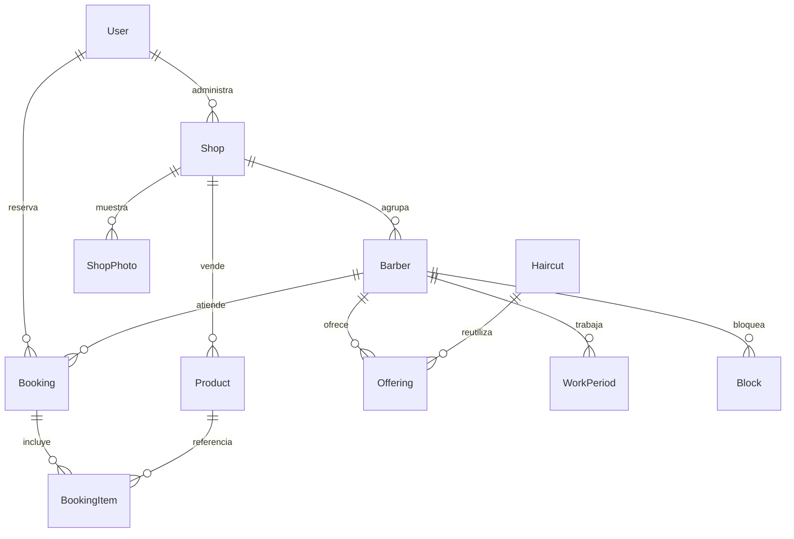
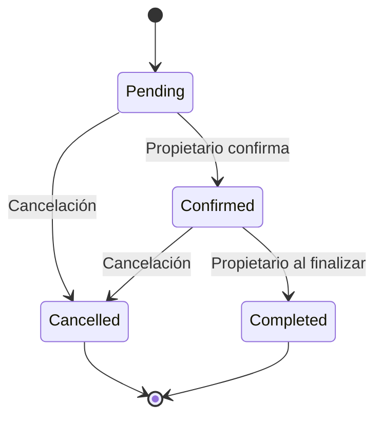

# Modelo y reglas de la primera versión

| Entidad | Responsabilidad |
|---|---|
| User | Cuenta, correo único, hash de contraseña y rol Client/Barber/Admin. |
| Shop | Propietario, dirección, coordenadas y zona IANA. |
| Barber | Profesional de un establecimiento; sin credenciales independientes en esta versión. |
| Haircut | Catálogo global administrado; veinte estilos iniciales. No pretende enumerar todos los estilos ni declarar tendencias actuales. |
| Offering | Relación única profesional/corte, precio, duración y disponibilidad. |
| WorkPeriod | Día 0–6 (domingo=0), inicio y fin en minutos de la jornada local. Varios periodos permiten descansos. |
| Block | Intervalo UTC que impide reservas. Se rechaza si invade una cita activa. |
| Product | Oferta de cada establecimiento y unidades libres para encargar. |
| Booking | Cliente, profesional, intervalo UTC, estado y copia del nombre/precio del servicio y total. |
| BookingItem | Nombre y precio unitario históricos, cantidad y referencia al producto. |
| MailJob | Destinatario, mensaje, intentos y siguiente reintento. Se inserta junto con la cita. |

Una reserva corresponde a un corte y un profesional. Se admite reservar desde ahora hasta 180 días adelante. Los horarios sugeridos avanzan en intervalos de 15 minutos; el backend valida siempre el intervalo completo. Los intervalos son semiabiertos: una cita puede empezar exactamente cuando termina otra.

Los precios son `decimal(10,2)` en MXN. El servidor vuelve a leer precios y stock al confirmar la solicitud; el total del navegador es orientativo. No se reciben totales del cliente. El final de la cita conserva la duración original aunque se edite la oferta.

## Concurrencia

Cada alta o cambio de estado de una cita abre una transacción InnoDB y toma un bloqueo de fila del profesional (`FOR UPDATE`). Después comprueba horario, bloqueos y citas activas. Los productos se bloquean por ID ascendente. Así se serializan las reservas del mismo profesional y se evita la sobreventa incluso entre profesionales distintos. Los cambios de oferta y horarios usan el mismo bloqueo. Las modificaciones de producto bloquean su fila.

Si se agrega una futura ruta para modificar citas, disponibilidad o inventario, debe respetar el mismo orden: profesional, productos por ID ascendente. No se debe escribir directamente en esas tablas desde otras aplicaciones sin estas garantías.

## Estados

El cliente puede cancelar únicamente sus propias citas antes de que comiencen. El propietario puede cancelar citas de sus establecimientos y marcarlas completadas cuando han finalizado. Cancelled y Completed son terminales. Solo la cancelación devuelve existencias; completar conserva las unidades ya descontadas.

## Datos y mantenimiento

La eliminación de entidades relacionadas está restringida para conservar el historial. Productos, profesionales y ofertas se desactivan; no se borran si ya están referenciados. Las fotos son opcionales y se guardan en disco con un nombre aleatorio. La API valida tamaño, firma y extensión de imagen, sin aceptar SVG. Las fotos eliminadas del perfil dejan de aparecer en las consultas públicas.

No hay datos de establecimientos ficticios en la carga inicial. Las pruebas crean sus propios datos en una base dedicada. Las contraseñas, conexiones y SMTP van en variables de entorno. Las sesiones y solicitudes de escritura usan cookies y token CSRF en el mismo origen.

## Límites conocidos

La agenda pertenece a la cuenta propietaria y reúne todos sus establecimientos; no hay cuentas de empleado independientes todavía. Los productos se encargan con cita y se pagan al acudir. Cambiar el horario o desactivar un barbero no cancela citas existentes. Los avisos se envían al propietario y deben procesarse con un único trabajador; el envío SMTP real necesita configuración y una prueba con el proveedor elegido.
